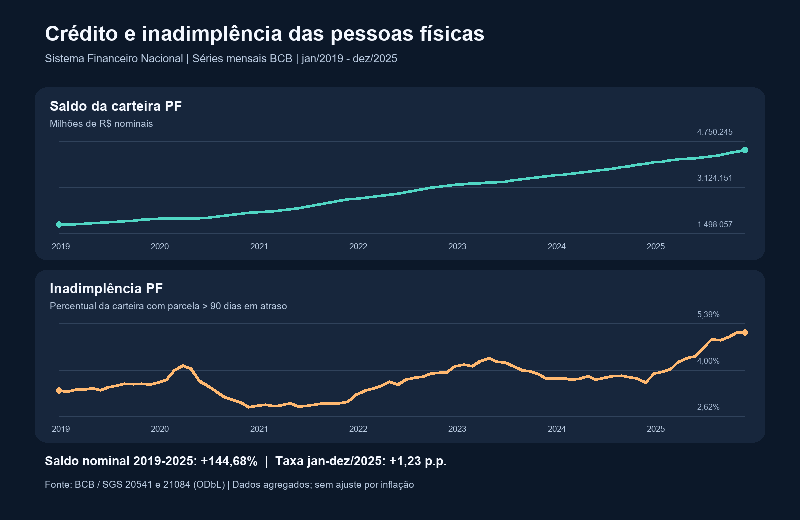

# Painel do crédito e da inadimplência das pessoas físicas

Análise reproduzível de séries públicas do **Banco Central do Brasil** para acompanhar o saldo de crédito a pessoas físicas e a taxa de inadimplência no Sistema Financeiro Nacional (SFN), de **janeiro/2019 a dezembro/2025**. Por Gabriel Oliveira.



## Objetivo e método

Alinhei **84 observações mensais** das séries SGS 20541 e 21084 pela chave `mes`, explorei os indicadores em **SQL/SQLite** e preparei séries, cálculos e um gráfico em **Python/pandas/Plotly**. O painel local permite filtrar anos, examinar os dois indicadores e baixar a tabela filtrada. As consultas e os scripts analíticos estão em `consultas/` e `analises/`; os componentes de leitura, execução e interface estão identificados em `apoio/`, `executar.py` e `dashboard.py`.

## Achados nos dados deste recorte

1. O **saldo nominal** passou de **1.812.785 milhões de R$** (jan/2019) para **4.435.517 milhões de R$** (dez/2025): variação de **+144,68%**. Este é crescimento *nominal*, não corrigido pela inflação.
2. A taxa de **inadimplência PF** passou de **3,89%** (jan/2025) para **5,12%** (dez/2025): **+1,23 ponto percentual**. Uma diferença positiva indica **aumento**, não redução da taxa.
3. Entre **dez/2024 e dez/2025**, o saldo nominal cresceu **+11,85%** e a taxa passou de **3,63% para 5,12%** (**+1,49 p.p.**). Esses movimentos foram observados no mesmo período; não demonstram causa e efeito.

Os indicadores mensais alinhados e o cálculo estão em `resultados/tabelas/` e `resultados/metricas.json`. O gráfico interativo produzido na análise está em `resultados/graficos/grafico_saldo.html`.

## Executar do zero no Windows

Requer **Python 3.12+**. Na pasta deste repositório, em PowerShell:

```powershell
python -m venv .venv
.\.venv\Scripts\python.exe -m pip install -r requirements.txt
.\.venv\Scripts\python.exe executar.py
.\.venv\Scripts\python.exe -m streamlit run dashboard.py --server.address 127.0.0.1
```

O terceiro comando refaz as consultas e os scripts em `resultados/reexecucao/`; o último abre o painel no navegador local. Os arquivos deste repositório são suficientes para reproduzir a análise; os snapshots estão em `dados/` e são conferidos por hash.


## Fonte e limitações

BCB SGS **20541** (saldo nominal, milhões de R$) e **21084** (inadimplência, % da carteira com parcela >90 dias em atraso), período jan/2019–dez/2025. Atribuição, URLs, hashes e licença **ODbL** em [FONTES_E_LICENCA.md](FONTES_E_LICENCA.md). Estas são séries **agregadas do SFN**, não dados de clientes ou de um banco específico. Não há correção monetária nem base para afirmar causalidade entre os dois indicadores. O cenário de demanda é fictício; o Banco Horizonte não é uma instituição real nem uma fonte destes dados.
